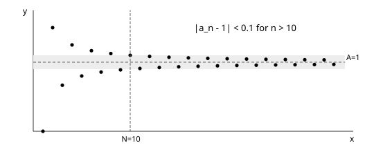

# 第2章 数列极限

## 2.1 极限定义与基本性质

数列 $\{a_n\}$ 收敛到 $A$，是指

$$
\forall\varepsilon>0,\ \exists N\in\mathbb N^+,\ \forall n>N:\ |a_n-A|<\varepsilon.
$$

$N$ 可以依赖 $\varepsilon$，但须同时控制之后的所有项。定义的否定为：存在 $\varepsilon_0>0$，对任意 $N$ 都能找到 $n>N$ 使 $|a_n-A|\ge\varepsilon_0$。

图2.1　$a_n=1+(-1)^n/n$。取 $\varepsilon=0.1,N=10$ 后，所有 $n>N$ 的项落在误差带内。

收敛数列极限唯一，且必有界。改变有限项不影响极限。任意子列与原收敛数列具有同一极限；若两个子列极限不同，则原数列发散。

若 $a_n\to A,b_n\to B$，则和、差、积的极限分别为 $A\pm B,AB$。若 $B\ne0$，且分母最终非零，则 $a_n/b_n\to A/B$。保序性保证 $a_n\le b_n$ 最终成立时 $A\le B$，严格不等号未必保留。

**例2.1　按定义证明。** 证明 $\dfrac{2n+1}{n+2}\to2$。

$$
\left|\frac{2n+1}{n+2}-2\right|=\frac3{n+2}<\frac3n.
$$

给定 $\varepsilon>0$，取 $N=\max\{1,\lceil3/\varepsilon\rceil\}$，则 $n>N$ 时误差小于 $\varepsilon$。定义证明应先控制误差，再给出可用的 $N$。

## 2.2 夹逼与单调有界

若最终有 $b_n\le a_n\le c_n$，且 $b_n,c_n\to A$，则 $a_n\to A$。特别地，$|a_n|\le b_n$ 且 $b_n\to0$ 时 $a_n\to0$。

单调递增且有上界的数列收敛，极限为各项集合的上确界；单调递减且有下界同理。递推数列的正确顺序为：找不变区间、证单调、证收敛，再代入递推关系。

**例2.2　递推极限。** 设 $a_1=1,a_{n+1}=\sqrt{2+a_n}$，求极限。

归纳得 $1\le a_n<2$。又

$$
a_{n+1}^2-a_n^2=2+a_n-a_n^2=(2-a_n)(a_n+1)>0,
$$

故数列递增并有上界，存在极限 $L$。连续性给出 $L=\sqrt{2+L}$，即 $(L-2)(L+1)=0$。由于 $L\ge1$，故 $L=2$。

## 2.3 常见量级与数列计算

对 $p>0$、$|q|<1$，$n^{-p}\to0,q^n\to0$。对固定 $a$，$a^n/n!\to0$。指数、幂、对数的增长比较要注明底数和指数范围，例如 $a>1,p>0$ 时 $(\ln n)^p/n\to0,n^p/a^n\to0$。

**例2.3　根式有理化。**

$$
\sqrt{n^2+n}-n=\frac n{\sqrt{n^2+n}+n}=\frac1{\sqrt{1+1/n}+1}\longrightarrow\frac12.
$$

**例2.4　平均值极限。** 若 $a_n\to A$，则 $\dfrac1n\sum_{k=1}^na_k\to A$。证明时选 $N$ 使后段的 $|a_k-A|<\varepsilon$，把和拆为固定的前 $N$ 项与后段，前段除以 $n$ 趋零，后段平均误差小于 $\varepsilon$。

## 2.4 Stolz 定理：补充工具

设 $b_n$ 严格递增且 $b_n\to+\infty$。若

$$
\frac{a_{n+1}-a_n}{b_{n+1}-b_n}\longrightarrow L,
$$

则 $a_n/b_n\to L$，这里 $L$ 可以是有限值或正负无穷。应用前必须检查分母的单调性与发散性。该定理作为提供资料中的补充工具，基础证明仍优先使用极限定义和单调有界定理。

**例2.5　平方和极限。** 令 $a_n=\sum_{k=1}^nk^2,b_n=n^3$，则

$$
\frac{a_{n+1}-a_n}{b_{n+1}-b_n}=\frac{(n+1)^2}{3n^2+3n+1}\longrightarrow\frac13,
$$

从而 $\sum_{k=1}^nk^2/n^3\to1/3$。第11章的黎曼和可给出另一种解释。

## 2.5 本章检查

递推关系的形式极限仅用于确定候选值；有界性与收敛性分开检验；反例 $( -1)^n$ 表明有界数列可能发散。任何“对所有 $n$ 成立”的估计，都要检查首项。

## 资料依据

依据《微积分（甲）I 讲义》第2章与《期末考试高频考点与备考策略》的数列工具部分编写；例题及证明经重新推导。
